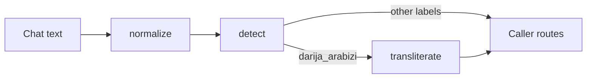

# darija-toolkit

Transliteration, detection and normalization for Moroccan Darija text.

Python package · FastAPI service · Typer CLI · [browser playground](https://mohamedtaqysalmi.github.io/darija-toolkit/)

[](https://github.com/mohamedtaqysalmi/darija-toolkit/actions/workflows/ci.yml)
[](LICENSE)

Status: **v0.1.0**. Rule-based Arabizi → Arabic script with ranked alternatives, heuristic script/language detection, chat normalization, a local API, a CLI, and a static Pages playground that ports the same rule tables to JavaScript.

Fixtures are drafted and not yet native-speaker reviewed. Scores are hand-set weights, not calibrated probabilities. Accuracy claims below refer only to the fixture set run in CI.

## Why

Chatbot and NLP pipelines in Morocco often see Arabizi (`salam labas 3lik`), Arabic-script Darija, MSA and French in the same thread. Most stacks assume clean MSA or French. This toolkit is a small, offline pre-processor for that middle ground: explainable rules, shared fixtures, and strict xfails for cases the rules still get wrong.

## Install (dev)

Requires Python 3.11 or newer. CI tests 3.11 and 3.14. On some bleeding-edge Windows builds (for example Python 3.15), prefer `uvicorn` without the `[standard]` extras so optional C extensions such as PyYAML are not required.

```bash
git clone https://github.com/mohamedtaqysalmi/darija-toolkit.git
cd darija-toolkit
python -m venv .venv
.venv/Scripts/activate        # Windows; on Linux/macOS: source .venv/bin/activate
pip install -e ".[dev]"
pre-commit install
```

Optional local API settings: copy [`.env.example`](.env.example) if you use a dotenv loader. The package itself does not need secrets.

## Library usage

```python
from darija_toolkit import transliterate, detect, normalize

print(transliterate("salam labas 3lik").text)  # سلام لاباس عليك

# Ambiguous tokens come with ranked alternatives and heuristic scores.
token = transliterate("kan7ebbek").tokens[0]
print(token.best)          # Candidate(text='كنحبك', score=…)
print(token.alternatives)  # next-best spellings, best first

print(detect("wach bghiti merci").label)  # mixed (or darija_arabizi / french / …)
print(normalize("saaaafi!!!").text)       # safi!
```

### Transliteration

Rule-based: digraphs first (`ch`, `kh`, `gh`, `ou`), chat digits (`2 3 5 6 7 8 9`), elongation collapsing (`mzyaaaan`), then a small lexicon for frequent words the letter rules handle badly. Short vowels are guessed, so many words come out with a plausible but not the usual spelling.

Cases the rules currently get wrong stay in `fixtures/transliteration.json` marked `known_failure` and run as strict xfails.

### Detection

Heuristic labels per segment: `darija_arabizi`, `darija_arabic`, `msa`, `french`, or overall `mixed`. Keyword and script cues only — not a trained classifier.

### Normalization

Collapses elongations, maps a few Arabizi spelling variants, squeezes punctuation and whitespace. Aimed at chat pre-cleaning; Arabic script is left alone. Designed to be idempotent on the outputs we care about.

## CLI

```bash
darija-toolkit transliterate "salam labas 3lik"
darija-toolkit detect "wach bghiti merci" --json
darija-toolkit normalize "saaaafi!!!"
echo "labas 3lik" | darija-toolkit transliterate
darija-toolkit version
```

## API

```bash
uvicorn darija_toolkit.api:app --reload
```

| Method | Path | Body | Notes |
|--------|------|------|--------|
| GET | `/health` | — | `{status, version}` |
| POST | `/transliterate` | `{"text": "…"}` | Arabic text + token alternatives |
| POST | `/detect` | `{"text": "…"}` | label + segments |
| POST | `/normalize` | `{"text": "…"}` | cleaned text + change count |

Interactive docs: `http://127.0.0.1:8000/docs`

## Playground

Static site under [`site/`](site/), deployed to GitHub Pages:

**https://mohamedtaqysalmi.github.io/darija-toolkit/**

The JS engine loads `rules.json` exported from the same tables as the Python package. Known failures on the page come from the shared transliteration fixtures.

## Pipeline



Callers compose the three functions; detection does not invoke transliteration on its own.

## Configuration

Almost none in v0.1.0. Rule tables live in `darija_toolkit.rules` (exported to `site/rules.json`). Fixture suites live under `fixtures/`. Optional `HOST` / `PORT` in [`.env.example`](.env.example) are for your shell when starting uvicorn — the package does not load `.env` itself.

## Testing

```bash
ruff check .
ruff format --check .
mypy
pytest
```

Coverage fails under 85% (`fail_under` in `pyproject.toml`). Transliteration cases marked `known_failure` are strict xfails. See [TEST_REPORT.md](TEST_REPORT.md) and [QA.md](QA.md). Architecture ADRs: [docs/architecture.md](docs/architecture.md).

## Limitations

- Fixtures are drafted; they are not native-speaker reviewed yet.
- Short vowels, ـة vs ا, emphatics and French loans are frequent miss points.
- Detector is keyword/script heuristics; short mixed messages mis-label often.
- Not published to PyPI in this release.
- Pages playground ports transliteration only; detect/normalize stay in Python for now.
- Demo GIF for the README is still a manual follow-up.

## Roadmap

Tracked under milestone [v0.2.0](https://github.com/mohamedtaqysalmi/darija-toolkit/milestones) after release. Likely next: fixture review pass, sync script for `site/rules.json`, richer detect fixtures, PyPI publish decision.

## Security notes

The HTTP API is a thin local/dev wrapper with no auth, rate limits or TLS termination. Do not expose it on a public interface without putting your own controls in front. Report vulnerabilities privately via [SECURITY.md](SECURITY.md).

## Contributing

See [CONTRIBUTING.md](CONTRIBUTING.md). Use invented examples only — no real chat logs or personal data in fixtures.

## License

MIT, see [LICENSE](LICENSE).
