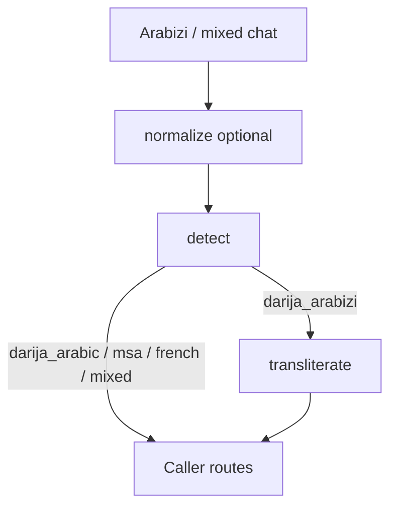

# darija-toolkit

**darija-toolkit** turns noisy Moroccan chat text into something a pipeline can route: Arabizi → Arabic script with ranked alternatives, a heuristic language/script detector, and a chat normalizer. It ships as a Python package, a Typer CLI, a small FastAPI app, and a browser playground.

## Demo

Live playground: [mohamedtaqysalmi.github.io/darija-toolkit](https://mohamedtaqysalmi.github.io/darija-toolkit/)

Status: **v0.1.0**. Rule-based, offline, test-backed. Fixture accuracy is measured only on the drafted suite (not native-speaker reviewed). Scores are hand weights, not probabilities. Demo GIF is still a manual follow-up.

## Quickstart

Requires Python 3.11+.

```bash
git clone https://github.com/mohamedtaqysalmi/darija-toolkit.git
cd darija-toolkit
python -m venv .venv
# Windows: .venv\Scripts\activate
# Linux/macOS: source .venv/bin/activate
pip install -e ".[dev]"
```

```bash
darija-toolkit transliterate "salam labas 3lik"
# سلام لاباس عليك

darija-toolkit detect "bonjour wach bghiti"
# mixed

darija-toolkit normalize "saaaafi!!!"
# safi!

uvicorn darija_toolkit.api:app --reload
# http://127.0.0.1:8000/docs
```

## Usage

### Python

```python
from darija_toolkit import detect, normalize, transliterate

print(normalize("mzyaaaaan").text)  # mzyaan
print(detect("wach bghiti").label)  # darija_arabizi
print(transliterate("salam labas 3lik").text)  # سلام لاباس عليك

token = transliterate("kan7ebbek").tokens[0]
print(token.best)  # Candidate(text='كنحبك', score=...)
print(token.alternatives)  # next-best spellings, best first
```

### CLI

```bash
darija-toolkit transliterate "labas" --json
echo "saaaafi" | darija-toolkit normalize
darija-toolkit detect "هذا الكتاب" --json
darija-toolkit version
```

### API

| Method | Path | Body | Notes |
| --- | --- | --- | --- |
| GET | `/health` | — | `{status, version}` |
| POST | `/transliterate` | `{"text": "..."}` | text + token alternatives |
| POST | `/detect` | `{"text": "..."}` | overall label + segments |
| POST | `/normalize` | `{"text": "..."}` | cleaned text + change count |

OpenAPI UI: `/docs` when uvicorn is running.

## Configuration

There is almost no runtime config in v0.1.0:

| Item | Where | Notes |
| --- | --- | --- |
| Rule tables | `darija_toolkit.rules` → `site/rules.json` | Hand-edited; export to site is still manual |
| Fixtures | `fixtures/*.json` | Drafted; `reviewed: false` until a speaker checks them |
| API host/port | [`.env.example`](.env.example) | Optional shell vars for uvicorn; package does not load `.env` |

## How it works



Transliteration order per token: lexicon hit → collapse elongations → digraphs and chat digits → position-aware vowels → expand one-slot alternatives. Decisions and trade-offs: [docs/architecture.md](docs/architecture.md).

## Testing

```bash
ruff check .
ruff format --check .
mypy
pytest
```

Coverage fails under 85% (`fail_under` in `pyproject.toml`). Cases marked `known_failure` in transliteration fixtures are strict xfails. See [QA.md](QA.md) and [TEST_REPORT.md](TEST_REPORT.md).

## Limitations

- Fixtures are drafted examples; they are not native-speaker reviewed yet.
- Short vowels, ـة vs ا, emphatics and French loans are frequent miss points.
- Detector is keyword/script heuristics; short mixed messages mis-label often.
- Not published to PyPI in this release.
- Pages playground ports transliteration only; detect/normalize stay in Python for now.

## Roadmap

Tracked under milestone **v0.2.0** on GitHub. Likely next steps: fixture review pass, sync script for `site/rules.json`, richer detect fixtures, PyPI publish decision, demo GIF.

## Security notes

The HTTP API is a thin local/dev wrapper with no auth, rate limits or TLS termination. Do not expose it on a public interface without putting your own controls in front. Report vulnerabilities privately via [SECURITY.md](SECURITY.md).

## Contributing

See [CONTRIBUTING.md](CONTRIBUTING.md). Use invented examples only — no real chat logs or personal data in fixtures.

## License

MIT, see [LICENSE](LICENSE).
