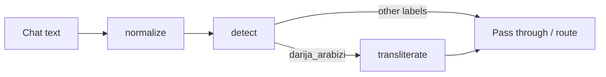

# Architecture

Short decisions for v0.1.0. Each ADR is one choice and what it costs.

## ADR-001: Rule tables as data, not a trained model

**Decision.** Transliteration lives in plain Python/JSON tables (`rules.py` → `rules.json` for the browser). Scoring is hand-weighted.

**Why.** Offline install, tiny package, explainable options in interviews, and a JS port that shares the same fixtures.

**Trade-off.** Accuracy on free chat text will lag a fine-tuned model. Short vowels are guessed. Fixture accuracy is the only measured number so far.

## ADR-002: Shared fixtures drive Python tests and the Pages playground

**Decision.** `fixtures/transliteration.json` is the source of truth for expected Arabizi→Arabic cases. The site ships a copy (`site/fixtures-transliteration.json`) and loads `site/rules.json` exported from the same tables.

**Why.** Drift between the package and the demo would show up in public.

**Trade-off.** Exports are manual until a sync script lands (tracked for v0.2.0). Reviewers must update both copies when rules change.

## ADR-003: Strict xfails for known wrong spellings

**Decision.** Cases the engine currently gets wrong stay in the suite with `known_failure: true` and `pytest.xfail`.

**Why.** Hiding them would inflate pass rates. Dropping them would lose coverage of hard spots (ـة vs ا, emphatics, loans).

**Trade-off.** The headline “N passed” still needs the xfail count next to it. Fixture expected values are drafts until a native speaker reviews them.

## ADR-004: Heuristic detector, not a classifier

**Decision.** `detect()` labels segments with script cues, chat digits, digraphs and short keyword lists. Overall label is `mixed` when more than one label appears.

**Why.** Good enough as a chatbot pre-filter; no model weights to ship; scores stay relative.

**Trade-off.** Short mixed messages mis-label often. Scores are not calibrated probabilities.

## ADR-005: Thin FastAPI + Typer over the same library calls

**Decision.** HTTP and CLI are thin wrappers around `transliterate`, `detect` and `normalize`. No separate service layer.

**Why.** One behavior surface for tests; interview demos can use package, CLI or `/docs` without divergent logic.

**Trade-off.** Auth, rate limits and batching are out of scope for v0.1.0. The API is meant for local/dev use until that changes.

## Pipeline sketch

Normalization is optional upstream of detect/transliterate. Detection does not call transliteration; callers compose the three functions.
